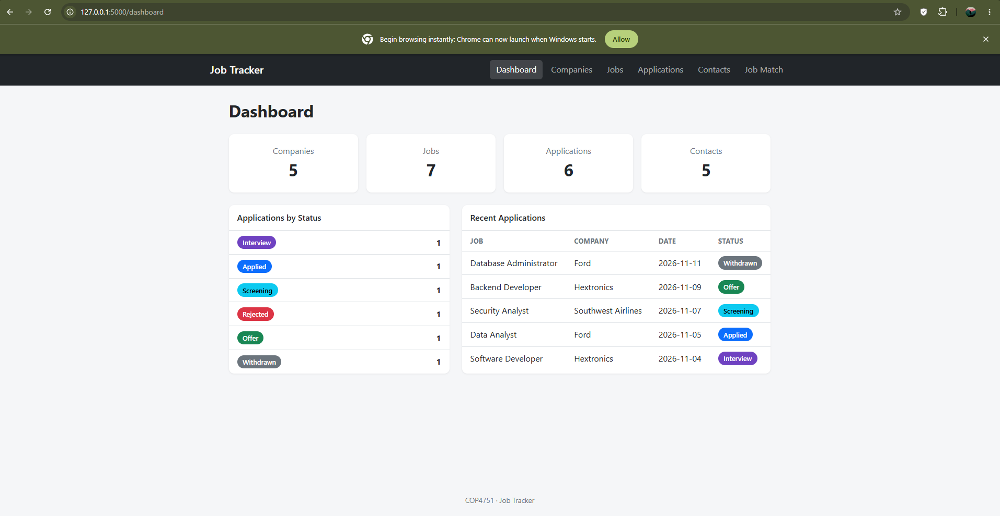
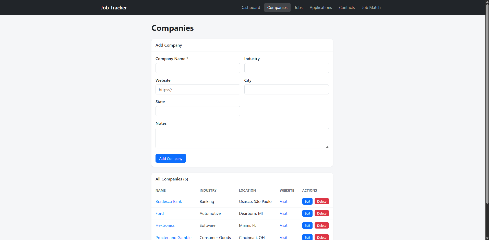
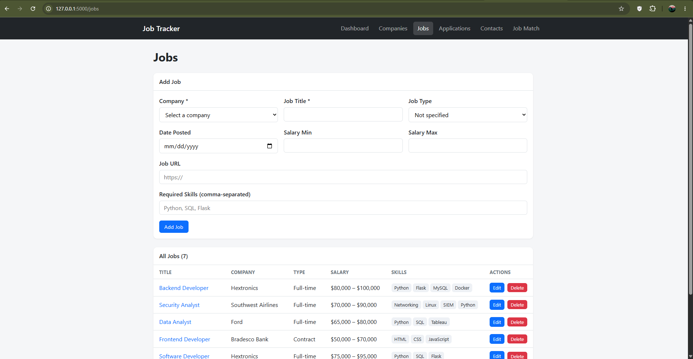
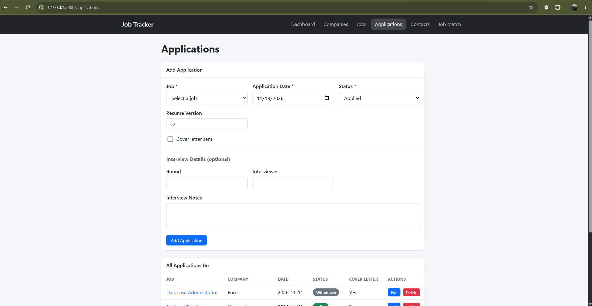
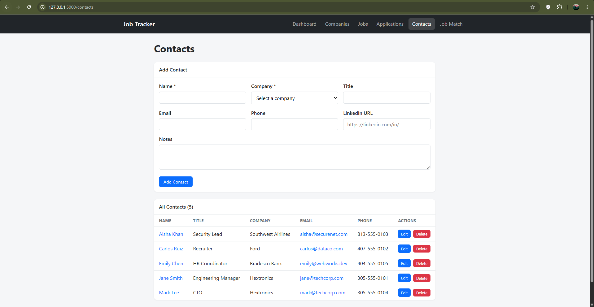
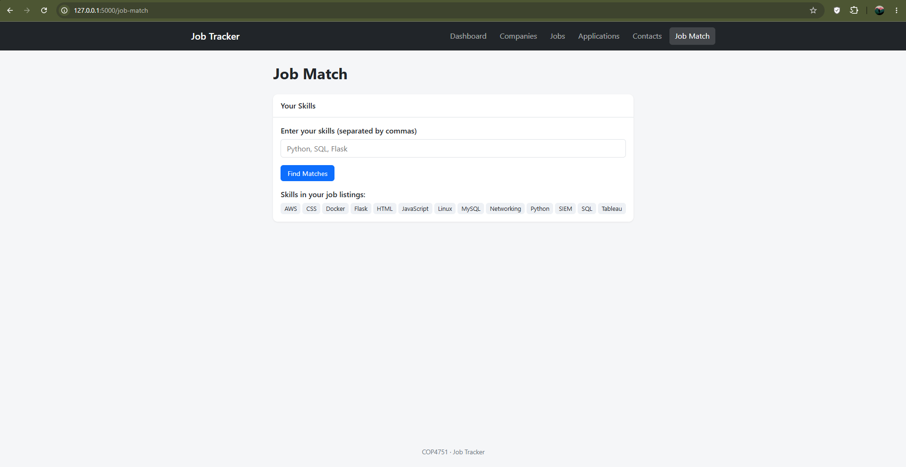

# Job Tracker

A web application for tracking job applications, built for COP4751.
I built it using MySQL, Python (Flask), and HTML/CSS.

## Features
**Dashboard** : displays the totals for companies, jobs, applications and contacts, applications by status, and recent applications, all visible in one spot
**Companies, Jobs, Applications, Contacts** : full CRUD (create, list, detail view, edit, delete with confirmation) including server side validation
**Job Match** : here you can enter your skills and jobs will be matched percentually to them, displaying also matched and missing skills

## Tech Stack
Database: MySQL 8
Backend: Python 3 with Flask
Frontend: HTML, Jinja templates and custom CSS (didnt use a framework)

## Setup Instructions

**First: Clone the repository**
   git clone https://github.com/RobotsandMachines/job-application-tracker
   cd job-application-tracker

**Second: Create the database**
   Open and run `schema.sql` in MySQL Workbench.

**Third: Create a virtual environment and install dependencies**
   python -m venv venv
   .\venv\Scripts\Activate.ps1
   pip install -r requirements.txt

**Fourth: Create a `.env` file in the project folder**
   DB_HOST=localhost
   DB_USER=root
   DB_PASSWORD=(your_mysql_password)
   DB_NAME=job_tracker_project
   SECRET_KEY=any_random_string

**Fifth: Run the app**
   Type in your Command Line:
   python app.py
   Open http://127.0.0.1:5000

## Project Structure
job-application-tracker/
├── app.py              # Flask routes, validation and helpers
├── database.py         # Database connection
├── schema.sql          # Database creation script + sample data
├── templates/          # HTML templates (base + one per page)
├── static/style.css    # Custom styles
├── requirements.txt    # Python dependencies
├── AI_USAGE.md         # GenAI usage documentation
└── README.md

## Database Schema
**companies**: company info
**jobs**: the job postings
**applications**: the applications to said jobs
**contacts**: people at the companies

## Screenshots

